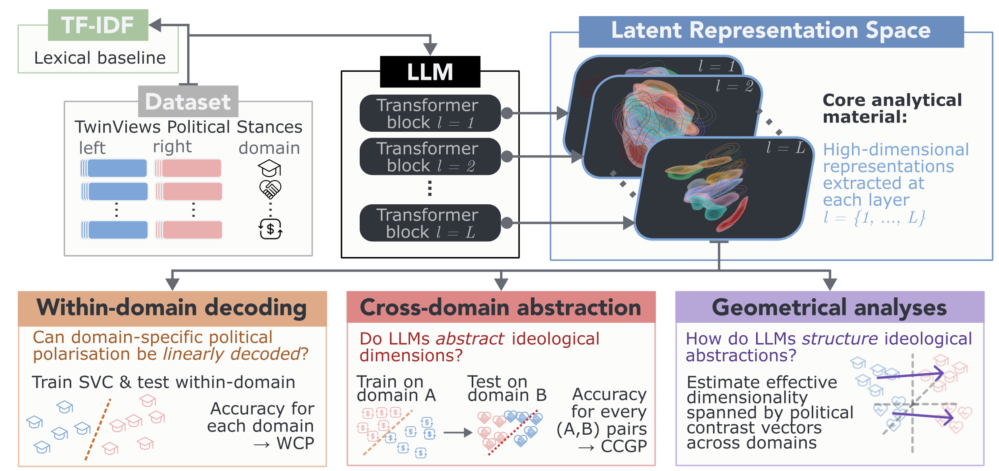

# The Geometry of Political Abstraction in Large Language Models

[](https://aclanthology.org/2026.blackboxnlp-1.43/)

This repository hosts the code used for the paper:
> **"The Geometry of Political Abstraction in Large Language Models"**  
> Noé Durandard, Saurabh Dhawan, and Thierry Poibeau  
> *Proceedings of the 9th BlackBoxNLP Workshop: Analyzing and Interpreting Neural Networks for NLP* (2026).
> [Paper Link](https://aclanthology.org/2026.blackboxnlp-1.43/) | [DOI: 10.18653/2026.blackboxnlp-1.43](https://doi.org/10.18653/2026.blackboxnlp-1.43)

### Table of Contents

1. [Introduction](#introduction)
2. [Repository Structure](#repo_structure)
3. [Installation & Setup](#installation)
4. [Data & Models](#data)
5. [Configuration & Parameters](#configuration)
    1. [Experimental configurations](#exp_config)
    2. [Data configurations](#data_config)
6. [Experimental Pipeline](#pipeline)
    1. [Step 1: Hidden states extraction](#pipe_extraction)
    2. [Step 2: Metrics computation](#pipe_metrics)
    3. [Step 3: Diagnostic figures generation](#pipe_viz)
7. [Citation](#citation)

---

<a id='introduction'></a>
## Introduction

This repository provides the code and evaluation pipeline for studying the "abstraction" (as defined in [(Bernardi et al., 2020)](https://www.sciencedirect.com/science/article/pii/S0092867420312289)) of concepts within the latent representation spaces of Large Language Models (LLMs) across layers.

The framework measures probe classification performance within- and across-domains; as well as contrast vectors participation ratios. The metrics are computed on hidden states vector representations extracted at each layer of the models.
The overall experimental pipeline is illustrated on the diagram below:



The showcased experiments use binary (left/right) political stances over diverse policy domains, extracted from the TwinViews dataset [(Fulay et al., 2024)](https://aclanthology.org/2024.emnlp-main.508/), as a naturalistic test case.
While demonstrated here on ideology, the underlying geometry and evaluation metrics are generalizable to any structured (binary) concept, given that the data format complies with the implemented architecture.

---

<a id='repo_structure'></a>
## Repository Structure

```text
.
├── additional_material/   # Poster and additional material
├── configs/               # Root-level JSON configuration files (data & experiment parameters)
|      ├── data_config.json
|      └── exp_config.json
├── data/                  # Preprocessed datasets and raw data preprocessing scripts
|      ├── preprocessing/
|      └── preprocessed/
|             └── twinviews_prepro.csv
├── scripts/               # Core Python scripts (extraction, metrics, visualizations)
|      ├── metrics/
|      |      ├── ccgp.py
|      |      └── participation_ratio.py
|      ├── sampling/
|      |      └── bootstrap.py
|      ├── visualisation/
|      |      ├── plot_classification.py
|      |      ├── plot_pr.py
|      |      ├── utils.py
|      |      └── visualisation.py
|      ├── get_activations.py
|      ├── pipeline.py
|      └── utils.py
├── visualisation.ipynb    # Notebook for visualisations exploration
├── requirements.txt       # Python dependencies list
└── README.md              # Project documentation
```

---

<a id='installation'></a>
## Installation & Setup

### 1. Clone the Repository
```bash
git clone https://github.com/d-noe/llm_political_abstraction.git
cd llm_political_abstraction
```

### 2. Environment Setup
We recommend setting up a virtual environment (via `venv` or `conda`):
```bash
python -m venv venv
source venv/bin/activate  # On Windows: venv\Scripts\activate
pip install -r requirements.txt
```

> [!WARNING]
> **Hardware Recommendation:** While probing, statistical analyses, and plotting scripts can be run on CPU, **extracting hidden states** from open-weight LLMs requires GPU acceleration for optimal performance.

---

<a id='data'></a>
## Data & Models

### Dataset

While the codebase remain general (as the study of *'abstraction'* of a given concept across domains within LLMs), the experiments ran in the context of the article *The Geometry of Political Abstraction in LLMs* focus on the concept of political polarisation through left- and right- leaning stances across diverse policy issues.
As such, they rely on a reworked and filtered version of the TwinViews dataset [(Fulay et al., 2024)](https://aclanthology.org/2024.emnlp-main.508/).

Both the preprocessed dataset used in the paper and the script used to filter the original source data are included in the [data folder](./data).

For more general considerations regarding the expected structure of the data for the implemented code, please refer to the [data README.md](./data/README.md#data_format).

### Models

All experiments rely on open-weight LLMs available via Hugging Face (`transformers`). No custom model training or fine-tuning weights are required to run the pipeline.

As described in the article, this code was tested and run using medium-sized LLMs: two version of Llama-3.1 (`meta-llama/Llama-3.1-8B`, and `meta-llama/Llama-3.1-8B-Instruct`), and a version of OLMo-2 (`allenai/OLMo-2-1124-7B-Instruct`).

---

<a id='configuration'></a>
## Configuration & Parameters

The primary configuration files stored in `configs/` control both general experiment settings and data related configurations.
While most of the arguments can be overwritten when calling specific scripts, two main configuration files govern the experimental pipeline: [`configs/exp_config.json`](./configs/exp_config.json), and [`configs/data_config.json`](./configs/data_config.json).
The fields of these configuration files are described below.

<a id='exp_config'></a>
### Experimental configurations

[`configs/exp_config.json`](./configs/exp_config.json) stores the main experimental parameters (model selection, metrics parameters, etc.):

**General parameters:**

- `"dataset_name"`: name of the dataset used in the experiments (must be consistent with the name used in the [`data_config.json`](./configs/data_config.json)) (base value: `"twinviews"`)
- `"data_config_path"`: path to the data configuration file (base value: `"./configs/data_config.json"`)
- `"models_names"`: names of the models to study (base value: `["Llama-3.1-8B","Llama-3.1-8B-Instruct","OLMo-2-1124-7B-Instruct"]`)
- `"random_seed"`: fix random seed when available, shared value across scripts (base value: `92`)
- `"raw_outputs_folder"`: base folder to store outputs of the analytical pipeline (see [`scripts/pipeline.py`](./scripts/pipeline.py)) (base value: `"./outputs/raw_outputs/"`)
- `"verbose"`: print logs during computations, shared across scripts (base value: `true`)

**Latent representation extraction:**
- `"device_name"`: device to use during the hidden states extraction process (base value: `"cuda:0"`)
- `"batch_size"`: number of samples per batch for the hidden states extraction process (base value: `32`)
- `"max_length"`: maximum token length of inputs during the hidden states extraction process (base value: `512`)

**Probes classification:**
- `"cv_folds"`: number of cross-validation folds during the training/evaluation process of the probes, yields one score per CV fold (base value: `5`)
- `"compute_tfidf"`: whether or not to compute the lexical TF-IDF baseline scores (base value: `true`)

**Participation ratio:**
- `"bootstrap_samples"`: number of times to bootstrap data to get statistical estimates (base value: `100`)
- `"n_permutations"`: number of times to permute labels randomly for the null PR values used to compute statistical significance (base value: `200`)

**Visualisation**
- `"visualisation_output_folder"`: base folder to store the diagnostic figures (base value: `"./outputs/figures/"`)
- `"zoom_model"`: model used for 'zoomed-in' subplots (base value: `"Llama-3.1-8B-Instruct"` — must be one of the `"models_names"`)
- `"zoom_layers"`: layers used for 'zoomed-in' subplots (base value: `[2,14,30]` — the numbers of `"zoom_layers"` must be 3)
- `"figures_format"`: format to save the figures (base value: `"pdf"`)
- `"ccgp_viz"`: whether or not to make the CCGP figure (base value: `true`)
- `"pr_viz"`: whether or not to make the PR figure (base value: `true`)
- `"corr_viz"`: whether or not to make the CCGP-PR correlation figure (base value: `true`)

<a id='data_config'></a>
### Data configurations

[`configs/data_config.json`](./configs/data_config.json) stores information related to the enquired data (file paths, column mappings, etc.). It is constructed as a dictionary of dictionaries, where the first-level entry is the name of the dataset: `<dataset_name>` (which must be consistent with the one in the experimental configuration file).

For each dataset, the second level entries contain:

- `"dataframe_path"`: path to the source `.csv` dataframe (base value for `"twinviews"`: `"./data/preprocessed/twinviews_prepro.csv"`)
- `"text_col"`: name of the column storing the textual inputs (base value for `"twinviews"`: `"statement"`)
- `"label_col"`: name of the column storing the decoding labels (base value for `"twinviews"`: `"label"`)
- `"domain_col"`: name of the column storing the domain/condition labels (base value: `"issue"`)
- `"id_col"`: name of the column storing the identifier of the samples (base value for `"twinviews"`: `"data_id"`)
- `"pairwiseid_col"`: name of the column storing the identifier of the samples' groups (base value for `"twinviews"`: `"statement_id"`)
- `"labels"`: unique values of the decoding labels (base value for `"twinviews"`: `["l", "r"]`)
- `"hs_path"`: base path to store the hidden states representations (extracted using [`scripts/get_activations.py`](./scripts/get_activations.py)) (base value for `"twinviews"`: `"./outputs/tmp_outs/activations/twinviews/"`)


---

<a id='pipeline'></a>
## Experimental Pipeline

The framework is organized into three sequential steps, each executed via a dedicated Python script.

> [!TIP]
> All scripts primarily rely on the experiments configurations file (see [configs/exp_config.json](./configs/exp_config.json)), and use the parameters filled out in this file as default arguments.
> Thus, the parameters can be modified within the JSON files in `configs/`, or passed directly as command-line arguments to override them.

<a id='pipe_extraction'></a>
### Step 1: Extract Hidden States
Extract layer-wise latent representations from pre-trained Hugging Face LLMs based on the input prompts/dataset.

<details>
<summary><b>Command-Line Arguments for <code>get_activations.py</code> (Click to expand)</b></summary>

*Configuration Note: By default, all parameters are loaded from the JSON configuration file specified by `--exp_config` (default: `./configs/exp_config.json`). Any argument provided via the command line below will override its corresponding value in the configuration file.*

| Argument | Type | Default | Description |
| :--- | :--- | :--- | :--- |
| `--data_config_path` | `str` | `./configs/data_config.json` | Path to the data configuration file. |
| `--dataset_name` | `str` | `twinviews` | Name of the dataset to process, to retrieve information from the `data_config` file. |
| `--device_name` | `str` | `None` | Device identifier to use (e.g., `cuda`). |
| `--batch_size` | `int` | `32` | Batch size when gathering model activations. |
| `--max_length` | `int` | `512` | Maximum sequence length for input tokenization. |
| `--models_names` | `list[str]` | Llama-3.1-8B, Llama-3.1-8B-Instruct, OLMo-2-1124-7B-Instruct | List of model identifiers to extract hidden states from. |
| `--verbose` | `flag` | `False` | Enable verbose execution output. |

</details>

```bash
python scripts/get_activations.py --exp_config './configs/exp_config.json'
```

This script computes and stores the LLMs' hidden states representations for the provided dataset.

The texts used as inputs are extracted from the input data (`exp_config.json` -> `dataset_name`) within the source dataframe (stored at `data_config.json` -> `<dataset_name>` -> `dataframe_path`), under the predefined column (`data_config.json` -> `<dataset_name>` -> `text_col`).

These textual inputs are directly fed into the LLMs (without preprocessing or specific formatting), and, for each model, the hidden states representations are extracted at each layer at the last token position.
These vector representations are then stored at the path provided by `data_config.json` -> `hs_path` as `zarr` objects.


<a id='pipe_metrics'></a>
### Step 2: Compute Metrics
Calculate layer-wise probing classification accuracies within- and across-domains (WCP & CCGP); as well as contrast vectors' participation ratios.

<details>
<summary><b>Command-Line Arguments for <code>pipeline.py</code> (Click to expand)</b></summary>


*Configuration Note: This script reads default values from the JSON file passed to `--exp_config` (`./configs/exp_config.json`). CLI flags specified below take precedence over the configuration file values.*

| Argument | Type | Default | Description |
| :--- | :--- | :--- | :--- |
| `--data_config_path` | `str` | `./configs/data_config.json` | Path to data configuration file. |
| `--dataset_name` | `str` | `twinviews` | Name of the dataset, to read information from the `data_config` file. |
| `--models_names` | `list[str]` | Llama-3.1-8B, Llama-3.1-8B-Instruct, OLMo-2-1124-7B-Instruct | Names of the models to evaluate. |
| `--random_seed` | `int` | `92` | Random seed for reproducibility. |
| `--cv_folds` | `int` | `5` | Number of cross-validation folds for probe classification. |
| `--compute_tfidf` / `-tfidf` | `flag` | `True` | Compute lexical TF-IDF baseline for CCGP. |
| `--bootstrap_samples` | `int` | `100` | Number of bootstrap samples for PR computation. |
| `--n_permutations` | `int` | `200` | Number of permutations for null PR computation. |
| `--raw_outputs_folder` | `str` | `./outputs/raw_outputs/` | Base directory to store raw output metrics (including probes performances within- and cross-domains, as well as Gram matrices and PR values for observed, bootstrapped and null-permuted scenarios). | bootstrapped
| `--verbose` | `flag` | `False` | Enable verbose execution output. |

</details>

```bash
python scripts/pipeline.py --exp_config './configs/exp_config.json'
```

First, this script computes classification probes performance (on binary left-/right- leaning stance classification task) when evaluated within- and across-domains. In each scenario, the probes are trained using the activations data from individual domains, and then either evaluated on cross-validated test splits (within-domain) or on all vectors associated with every other domain (cross-domain).
Those performances are used to compute Within-Condition Performance (WCP) and Cross-Condition Generalisation Performance (CCGP).

Then, the script computes Participation Ratios (PR) based on domain-wise contrast vectors. The contrast vectors are computed as labels centroids, conditioned on domains, and used to compute a Gram matrix. The PR is then computed on the Gram Matrix. In addition to the observed PR, bootstraped PRs, and null (label-permuted) PRs are also computed.

The probes performances, Gram matrices, and PR values are all stored in the folder given by `exp_config.json` -> `raw_outputs_folder` (using the default config, see [./outputs/raw_outputs](./outputs/raw_outputs)).


<a id='pipe_viz'></a>
### Step 3: Generate Visualizations
Plot diagnostic figures corresponding to paper results.

<details>
<summary><b>Command-Line Arguments for <code>visualisation.py</code> (Click to expand)</b></summary>

*Configuration Note: The base settings are automatically populated from the JSON config path passed to `--exp_config` (`./configs/exp_config.json`), and can be selectively overridden using the arguments below.*

| Argument | Type | Default | Description |
| :--- | :--- | :--- | :--- |
| `--ccgp` | `flag` | `False` | Generate CCGP visualisations. |
| `--include_tfidf` / `-tfidf` | `flag` | `False` | Include TF-IDF lexical baseline in plots. |
| `--pr` | `flag` | `False` | Generate Participation Ratio (PR) visualisations. |
| `--corr` | `flag` | `False` | Generate CCGP/PR correlation plots. |
| `--pr_B` | `int` | `100` | Number of bootstrap samples used during PR calculation. |
| `--pr_perms` | `int` | `200` | Number of permutations used for null PR calculation. |
| `--figures_format` / `-f` | `str` | `pdf` | Output format for saved figures (e.g., pdf, png). |
| `--zoom_model` / `-m` | `str` | `Llama-3.1-8B-Instruct` | Model selected for detailed zoomed-in figures. |
| `--zoom_layers` / `-l` | `list[int]` | `[2, 14, 30]` | Layers for detailed views (must be exactly 3 layers). |
| `--raw_outputs_folder_path` / `-i` | `str` | `./outputs/raw_outputs/` | Input directory containing raw analysis metrics. |
| `--visualisation_output_folder` / `-o` | `str` | `./outputs/figures/` | Output directory where generated figures are saved. |
| `--dataset_name` | `str` | `twinviews` | Name of the dataset. |
| `--models_names` | `list[str]` | Llama-3.1-8B, Llama-3.1-8B-Instruct, OLMo-2-1124-7B-Instruct | Names of the models to visualize. |
| `--verbose` | `flag` | `False` | Enable verbose execution output. |

</details>

```bash
python scripts/visualisation/visualisation.py --exp_config "./configs/exp_config.json"
```

This script generates the figures included in the paper (including: WCP, CCGP, detailed probes performances, PR, detailed Gram matrices, and CCGP-PR correlation plot).
It uses the precomputed metrics stored at `exp_config.json` -> `raw_outputs_folder` (see *#Step 2*) to produce the diagnostic plots.
The figures are stored in the folder given by `exp_config.json` -> `visualisation_output_folder` (using the default config, see [./outputs/figures/](./outputs/figures/)).

---

<a id='citation'></a>
## Citation

Paper *The Geometry of Political Abstraction in Large Language Models* accepted for publication at BlackBoxNLP 2026 (at EMNLP 2026). The [poster](./additional_material/BlackboxNLP-56.pdf) presentation is provided in the [additional_material](./additional_material) folder.

```bibtex
@inproceedings{durandard-etal-2026-geometry,
    title = "The Geometry of Political Abstraction in Large Language Models",
    author = "Durandard, No{\'e}  and
      Dhawan, Saurabh  and
      Poibeau, Thierry",
    booktitle = "Proceedings of the 9th {B}lackbox{NLP} Workshop: Analyzing and Interpreting Neural Networks for {NLP}",
    month = oct,
    year = "2026",
    address = "Budapest, Hungary",
    publisher = "Association for Computational Linguistics",
    url = "https://aclanthology.org/2026.blackboxnlp-1.43/",
    doi = "10.18653/2026.blackboxnlp-1.43",
    pages = "739--760",
    ISBN = "979-8-89176-476-7",
}
```
